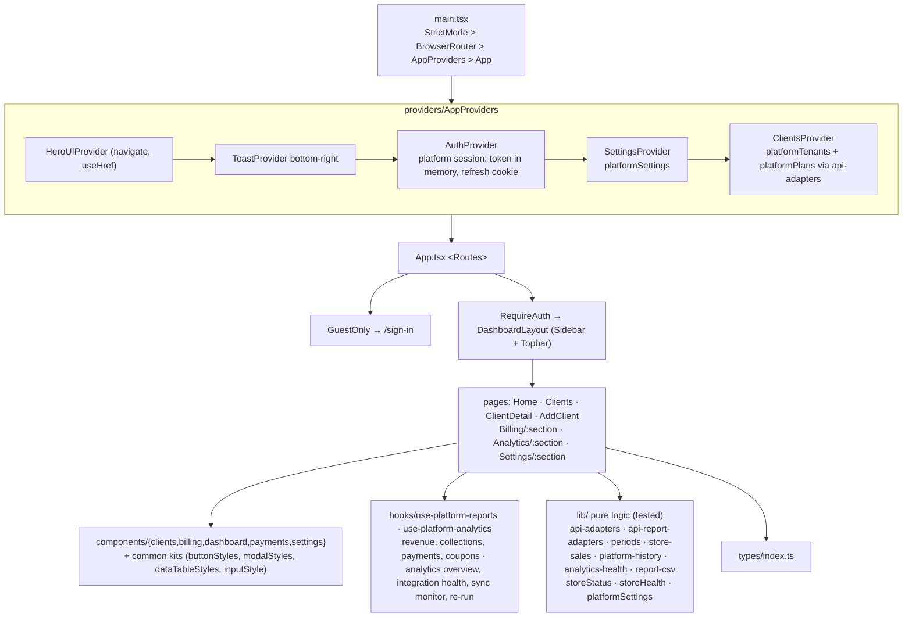
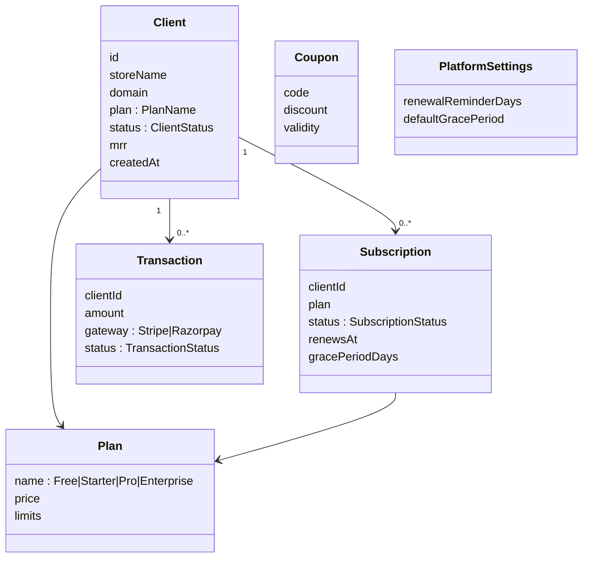
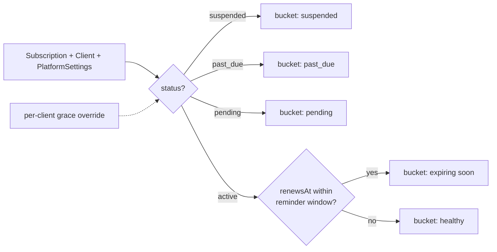
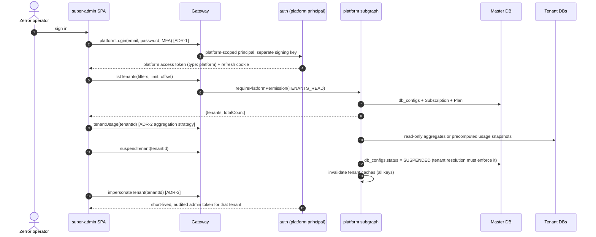
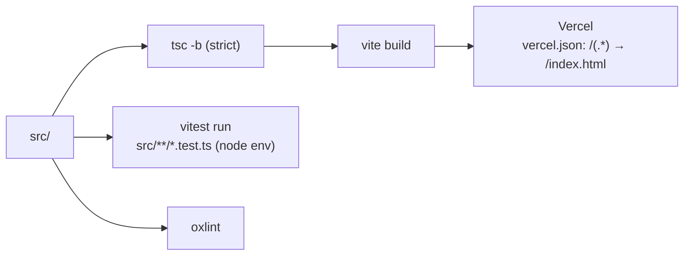

# zcom-super-admin: Solution Architecture (Platform Console)

| | |
|---|---|
| **Status** | Living document. Verified against code on **2026-10-13**; route map and hooks updated for PRD-012 on 2026-10-22 |
| **Parent** | Workspace `../ARCHITECTURE.md` |
| **Maturity** | **API-only (PRD-005 Phases 0–4, 2026-10-17).** Real sign-in, stores, lifecycle, subscriptions, billing, reports, Team, audit and impersonation from the `platform-admin` subgraph; the mock prototype was removed (Q14). Not yet run in a browser against a live gateway. |

---

## 1. Purpose

This is Zerror Studios' internal console for operating the Zcom platform:
- onboarding and managing **client stores** (tenants);
- plans and subscriptions, billing transactions and revenue reports;
- coupons and renewal-reminder automation;
- a per-client view of usage and health, with an "impersonate store" action.

Tenant staff use `zcom-frontend`; this console sits *above* all tenants.

## 2. Context: current vs target

## 3. Application architecture (current)

### Route map

| Route | Page | Sections / notes |
|---|---|---|
| `/sign-in` | SignIn | Behind `GuestOnly`. `platformLogin` with the TOTP step; "Forgot password?" links to `/forgot-password` |
| `/forgot-password` | ForgotPassword | Behind `GuestOnly` (PRD-014 FR-1.10). `platformRequestPasswordReset`; the same confirmation whether or not the email has an account |
| `/set-password?token=` | SetPassword | Public. Invite and reset links → `platformSetPassword` (8+ characters, PRD-014) |
| `/` | Home | KPI cards (revenue, MRR, stores, orders), revenue chart, plan mix, top clients |
| `/clients` | Clients | Table with status and health |
| `/clients/new` | AddClient | Plan (Free/Starter/Pro/Enterprise), status (trial/active/suspended) |
| `/clients/:id` | ClientDetail | Overview / Billing / Usage sections, "Login as store"; since PRD-012 an Analytics card (sync health, data through, last sync, "Re-run sync" for manage roles) read from the sync-monitor rollup; since 2026-10-26 Store details (PRD-017 FR-4.5), Go live and Lifecycle (PRD-018) sections |
| `/stores` (PRD-018) | Clients | under the table, "Deleted and purged stores": `platformTenants(filter: {status: [DELETED]})` (each opens the store page, restorable inside the grace period) and `platformPurgedTenants` (tombstones) |
| `/billing/:section` | Billing | `subscriptions`, `invoices` (PRD-017 FR-4.3: `platformInvoices`, server filters, 100 a page, detail dialog, existing row actions), `transactions` (since PRD-024 FR-1.6 `platformPayments(filter: {search, status})` from the URL, plan column = the payment's `planName`), `flagged` (PRD-016 FR-19: `platformPayments(filter: {flagged: true})`, `resolveFlaggedPlatformPayment` with a note), `stuck` (PRD-018 FR-1.8: `platformStalePendingPayments`, store payments in suspended stores still pending after 48 h; ids and amounts only), `reminders` |
| `/analytics/:section` | Analytics | `revenue` (Platform revenue, `platformRevenueOverview`), `store-sales` (since PRD-024 FR-3.4 `platformStoreSales(range)`: 7/30/90 days, totals per currency, per-store net revenue, orders, previous window, growth and AOV), `performance` (`platformAnalyticsOverview`, 7/30/90 days), `integrations` (`platformIntegrationHealth`, filters + paging), `sync` (`platformSyncMonitor` + `platformRerunAnalyticsSync`). All PRD-012 reads come from master collections the backend jobs write (`tenant_usage_snapshot`, `channel_connection`, `analytics_sync_summary`); the console never fans out to tenant databases |
| `/ai/:section` (PRD-021) | Ai | `overview` (`aiPlatformTotals`: spend vs cap and budget, `alertsCrossed` banner, resting note, model mix), `usage` (`aiUsageByTenant`, search, 25 a page; `aiUsageCsv` download), `top-ups` (`aiTopUpRequests(status)`, Open / Granted / Dismissed since PRD-024 FR-1.10; `grantAiTopUp`, `dismissAiTopUpRequest`), `data-health` (`aiDataHealth(needsAttention)`: true by default, false with "Show all stores", PRD-024 FR-1.10), `benchmarks` (`aiBenchmarks(period)`), `settings` (`aiConfig` / `updateAiConfig`, changed fields only). Reads `platform:ai:read` (nav hidden without it), changes `platform:ai:manage`. The store page has an AI section too (`aiTenantSetting`, `setTenantAiPaused`, `setTenantAiOverride`, grant, `aiTopQuestions` on request, audited) |
| `/settings/:section` | Settings | `plans` (PRD-017 FR-4.1: every plan version, counts, create / edit with the versioning notice, archive with a replacement, migrate stores), `discounts` (coupons), `billing-rules` (platform settings; since PRD-016/017 also bank-transfer text, support contact, the plan-limit mode and the overdue-payment timings with the gated switch), `team` (platform users, API only), `audit` (audit log, API only); `automation` redirects to `/billing/reminders`; `profile` (PRD-024 FR-4.3, System group: `platformMe` account and MFA status, "Set up again" → `/mfa`, `platformChangePassword`, `platformMySessions` with `revokePlatformSession`) |

## 4. Domain model (front-end types)

**Mismatch to resolve in the integration PRD.** The backend's master-DB `Plan.name` enum is `STARTER | PREMIUM | PLUS | ENTERPRISE`, and `Subscription.status` is `ACTIVE | TRIAL | PAST_DUE | CANCELLED | SUSPENDED`. The console uses `Free/Starter/Pro/Enterprise` and its own status set. One vocabulary must be chosen.

## 5. Subscription-health logic (tested core)

This logic lives in `lib/subscriptionHealth.ts`, which has tests in `subscriptionHealth.test.ts`. The reports in `subscriptionReports.ts` and `revenueReports.ts` reconcile their overview totals with the drill-down counts, and those are tested too.

## 6. Integration architecture (PRD-005)

**Current (Phase 1, 2026-10-17).** The backend has the platform principal (ADR-001, Accepted) and the `platform-admin` subgraph. This repo talks to it through `src/lib/apollo-client.ts` (auth link, silent refresh on `TOKEN_EXPIRED` with a single-flight, cross-tab lock, proactive refresh, error codes), with the access token in memory (`lib/session-store.ts`) and the refresh token in the `__Host-zc_platform_rt` cookie. `AuthProvider` restores the session on load (`platformRefreshToken` → `platformMe`), runs the TOTP step on `MFA_REQUIRED`, and sends manage roles to `/mfa` to enrol. `ClientsProvider` maps `platformTenants` / `platformPlans` onto the console's `Client`, `Subscription` and `Plan` types (`lib/api-adapters.ts`) so every screen reads them unchanged. ADR-5 is answered: Apollo cache for server data, React context for session and UI state only. **Phase 2 (same day):** `ClientsProvider` also runs the lifecycle mutations (create with provisioning, update, notes, suspend with a reason, reactivate, soft delete with the slug), `SettingsProvider` holds the server settings, and the store page gained the provisioning card, subscription actions and editable notes; health and payment badges are server-computed (ADR-2 answered with daily usage snapshots in the master DB).

**PRD-014 Wave 1 (2026-10-25).** Platform mutations need the session's CSRF token (D8): `platformLogin` and `platformRefreshToken` return `csrfToken`, which `lib/session-store.ts` keeps in memory beside the access token (shared across tabs with it), and the Apollo auth link sends it as `x-zcom-csrf` on every mutation. A `FORBIDDEN` / `CSRF_REQUIRED` answer triggers one refresh and one retry; `ORIGIN_NOT_ALLOWED` is reported as its own toast. Staff reset their password by email (`/forgot-password` → `platformRequestPasswordReset` → `/set-password`). Provisioning emails the owner a set-password invite (`CreateTenantResult.ownerInviteSent`; the temporary password is null) and the store page can resend it (`resendOwnerInvite`). "Log in to store" opens an impersonation session of at most 1 hour.

**PRD-014 Wave 2 (2026-10-25, console side of FR-2.3, PLT-13, FE-16).** The Apollo HTTP link has a deadline (`createTimeoutFetch`, `VITE_HTTP_TIMEOUT_MS`, default 30 s) and `AuthProvider` signs out on a `platformMe` failure only when the server returns an auth code; a network failure keeps the session (or shows "Can't reach the server" with Retry during restore). The lists the backend caps (tenants and users at 100, payments at 200) are read with `offset` into one cached list (`lib/offset-paging.util.ts` field policies): stores load page after page until `totalCount`, payments and the store's billing history have "Load more", and the store page falls back to `platformTenant(id)` for a store not yet loaded. New operations (all existing backend fields, no contract change): `platformTenant`, `platformUsage`, `updatePlatformCoupon`, `deactivatePlatformCoupon`, `runPlatformJob`, `runUsageSnapshotJob`, `platformLogoutAll` (54 operations, validated). Team and Audit log skip their queries for roles without `users:manage` / `audit:read`.

**PRD-016 / PRD-017 console (2026-10-26, FR-26 and FR-4.1–4.3; against the built backend, `validate:clients` 65/65; deploy the backend first).** Store detail › Billing reads the subscription's `billingState`, `ordersPauseAt`, `suspendsAt`, `creditBalance` and plan version, the store's `platformInvoices` (`billingReason`, `restart`, `amountPaid`, `creditApplied`, `amountDue`; "Partially paid" is derived from `amountPaid > 0` on an open invoice) and `platformCredits`, with **Issue credit** (`issuePlatformCredit`), **Record refund** (`recordPlatformRefund`) and **Create custom plan** (`createPlan` with `tenantId`). **Change plan** lists `platformPlans(tenantId)` filtered to ACTIVE plans plus the current version, shows `previewTenantPlanChange` before confirming, allows `NOW` outside a trial, and turns the preview's `DOWNGRADE_AT_PERIOD_END` into an override with a required reason (`changeTenantPlan(override, reason)`). **Reactivation** always sends `override` + `reason` (`reactivateTenantSubscription`, `reactivateTenant`; the backend refuses a bare call). Billing › Flagged payments is the review queue; Settings › Plans the catalog (`createPlan`, `updatePlan`, `archivePlan`, `migratePlanSubscribers`, `platformPlan`); Settings › Billing rules saves dunning and `entitlementsMode` on their own (`updatePlatformSettings` with a partial input) and never sends `dunning.enabled: true` (gated, PRD-016 D6/D7). Pure rules in `lib/plan-catalog.util.ts` and `lib/platform-billing.util.ts` (tested).

**PRD-018 data lifecycle and PRD-017 FR-4.4/4.5 console (2026-10-26, working tree; `validate:clients` 75/75; deploy the backend first, because `updateTenant.domain` now answers `USE_DOMAIN_VERIFICATION`).** The store page is still one page (owner, 2026-10-16), so PRD-018 §6's "tabs" are sections. **Lifecycle** (`StoreLifecycleCard`): state and suspension category chips, `tenantMoneyInFlight` (`MoneyInFlightPanel`, "partial" warning), suspend with a category (default POLICY) and reason, change the category of a suspended store, reactivate, delete (platform owner only; `MONEY_IN_FLIGHT` lists the blockers from `extensions.counts`, and "Delete anyway" needs `force` + `forceReason`; `CONFLICT` `TENANT_CHANGED`, the conditional delete losing a race, gets plain "nothing was deleted, reload" copy, review CP2-07), restore with the purge countdown, and the store's payments pending over 48 h. **Go live** (`StoreGoLiveCard`): domain status, `startDomainVerification` (TXT `recordName` / `recordValue`, copyable), `checkDomainVerification` (last error, `DOMAIN_TAKEN`), `tenantGoLiveChecklist` (pass / fail / unknown / waived), `markTenantLive` with the waivable checks (`payment_app`, `legal_pages`) and a reason. **Store details** (`StoreDetailsCard`): `updateTenant` with only the changed fields; the domain is read-only and links to Go live. Coupons pick plan versions by id (`appliesToPlanIds`). Change plan previews a forced downgrade (`override: true`, `creditIssued`); Migrate stores shows the dry run (`previewPlanMigration`); the plan-limit mode change sends an optional audit `note`. Rules: `lib/tenant-lifecycle.util.ts`, `lib/coupon-form.util.ts`. FR-3 (exports, data requests) is gated on the legal review and has no console UI.

**PRD-024 Phase A, console data completeness (2026-10-27, working tree; no new operation, `validate:clients` 89/89).** Variable changes only: `platformPayments(filter: {search, status})` from the Transactions URL; `aiTopUpRequests(status)`; `aiDataHealth(needsAttention: false)` for "Show all stores"; `createTenant` sends `timezone` and `currency`; `sendRenewalReminders(channels: [EMAIL])`; `platformAuditLog(filter: {targetId: <tenant>})` feeds the store page's **Activity** section; `platformUsage(tenantId, months: 6)` feeds both the store page's **Performance** chart and Usage history (one query). The adapter (`lib/api-adapters.ts`) now keeps the snapshot date, staff count, region, `liveAt`, the subscription status, `daysOverdue` and the store's plan version (`Client.planRef`: id, version, custom, product and staff limits); plans are matched by id, never by tier name (`lib/plan-identity.util.ts`). Store lifecycle (D4): Live = `liveAt` set, else Set up / Trial / Past due / Cancelled / Suspended (Deleted as before) (`lib/storeStatus.ts`). The Home brief, the store insight and the Ask AI panel stay as before PRD-024 (D5, `lib/aiSamples.ts`). Settings stays disabled until the server copy loads, and a failed load shows an error with Retry (`SettingsProvider.error`, FR-1.1).

**PRD-024 Phases B–C, console (2026-10-27, working tree; `validate:clients` 94/94; deploy the backend first: `growthPercent` is nullable).** New operations: `PlatformMrrHistory` (`platformMrrHistory(from, to)`, reports:read; Platform revenue's MRR line and MRR movement table, months before the first snapshot "Not recorded"), `PlatformStoreSales` (`platformStoreSales(range, limit, offset)`, reports:read; Analytics › Store sales, 7/30/90 days, totals per currency), `PlatformReminderLog` (`platformReminderLog(tenantId, limit, offset)`, billing:read; `ReminderLogCard` under Billing › Reminders and on the store page), `PlatformJobRuns` (`platformJobRuns(job, limit)`, settings:manage; Run now's recent runs) and `PlatformInvoiceDetail` (`platformInvoices(filter: {tenantId, search: number})` selecting `statusHistory` and `payments`, read when the invoice dialog opens). Changed selections and variables: the tenant usage fragment adds `previousRevenue`, `previousOrders`, `partial`, `messagesThisMonth`; `platformAnalyticsOverview.kpis.storesWithSessions`; the revenue summary adds `trialPipeline`, `atRiskMrr` and the trend no longer selects the deprecated `mrr`; `platformPayments` selects `countsByStatus` (Transactions header); `platformCoupons` / `platformCouponCount` take `search` and `status` (cache keyed on them); `aiPlatformTotals` adds `answeredQuestions`, `cachedAnswers`; `aiUsageByTenant` takes `tenantId` (the store AI card). Collections KPIs are relabelled to the server's one-range definitions (Due, Collected · %, Received, Open, Overdue). Growth is nullable everywhere; null shows "—" with "No previous sales to compare". The Ask AI panel, Home brief and store insight are unchanged (D5).

**PRD-024 Phase D, console (2026-10-27, working tree; written against the source PRD before the backend fields existed: deploy the backend first; `validate:clients` fails on exactly these 8 operations until it lands).** New operations: `PlatformNotifications` (`platformNotifications(category, limit: 20, offset)`, one tab of the bell's panel, `PlatformNotificationsPanel`), `PlatformNotificationCounts` (the same field aliased `payments`/`stores`/`health` with `@include` per tab the role may open, `limit: 1`, only `unreadCount`; `pollInterval` 60 s with `skipPollAttempt` while the document is hidden, re-read on `visibilitychange`), `MarkPlatformNotificationsRead(ids)` (an opened item), `MarkAllPlatformNotificationsRead(category)` (per tab), `PlatformMessagingStatus` (billing:read; enables the SMS and WhatsApp reminder switches in Settings and on Payment reminders; `sendRenewalReminders(channels)` now carries the switched-on configured channels instead of `[EMAIL]`), `PlatformChangePassword`, `PlatformMySessions`, `RevokePlatformSession` (Settings › Profile & security, `/settings/profile`). Item links are followed only when they are console paths. The documents name the enum `PlatformNotificationCategory`; every other argument gets a non-null variable. `Client.ownerEmailSet` (from `owner.email`, no new field) drives the "No owner email" chip and the store page banner (FR-4.4).

**Target (Phases 2–4).** The sequence below is the full design from the PRD; the identity decision (ADR-1 here) is ADR-001 in the backend and is done.

| ADR | Decision needed |
|---|---|
| ADR-1 | **Platform identity:** a separate principal, key and cookie, or the existing admin with a platform scope. MFA requirement. |
| ADR-2 | **Cross-tenant metrics:** fan-out queries, an event-driven usage collection in the master DB, or the analytics service |
| ADR-3 | **Impersonation ("Login as store"):** token minting, expiry, audit trail |
| ADR-4 | **Platform billing provider:** Stripe or Razorpay (the console types) vs Nimbbl (tenant payments) |
| ADR-5 | **Client state after integration:** keep React context, or adopt Apollo cache conventions like zcom-frontend |

## 7. UI system

| Concern | Choice |
|---|---|
| Primitives | HeroUI 2.8 |
| Styling | Tailwind **v4**, configured in CSS: `@theme` tokens in `src/index.css`, and `@plugin "../hero.ts"` (light theme, primary `#3b82f6`) |
| Kits | `components/common/*Styles.ts`, `styles/inputStyle.ts`, `PageHeader`, `ConfirmModal`, `StatusChip`, `TableToolbar`, `NoDataPlaceholder` |
| Charts | recharts |
| Icons | lucide-react (preferred for new icons); react-icons in older files |
| Theme | Light only (`dark` class removed on mount) |

## 8. Build, test and deploy

## 9. Risks and gaps

| Gap | Impact | Path |
|---|---|---|
| Vercel topology | Resolved: Q6 decided 2026-10-18 (the console calls `https://api.zerrorstudios.com` directly, same site); the CSP `connect-src` allows that origin since PRD-014 FR-0.7 (2026-10-25) | A UAT build needs its API origin in `vercel.json` too (PRD-007 Q8 hosts) |
| Vocabulary mismatch with backend plans and statuses | Integration bugs | Settle it in the PRD |
| Notifications feed | Built in the console (PRD-024 FR-4.1.5, 2026-10-27); empty or erroring until the backend's `platformNotifications` is deployed | Deploy the backend first, then regenerate the console manifest |
