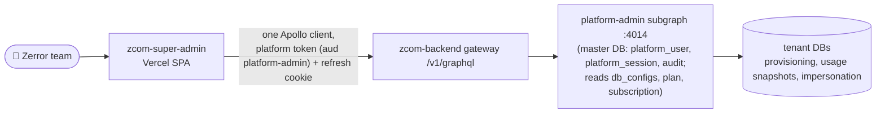
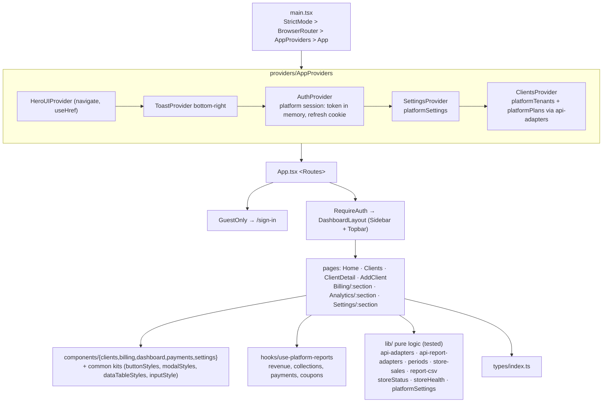
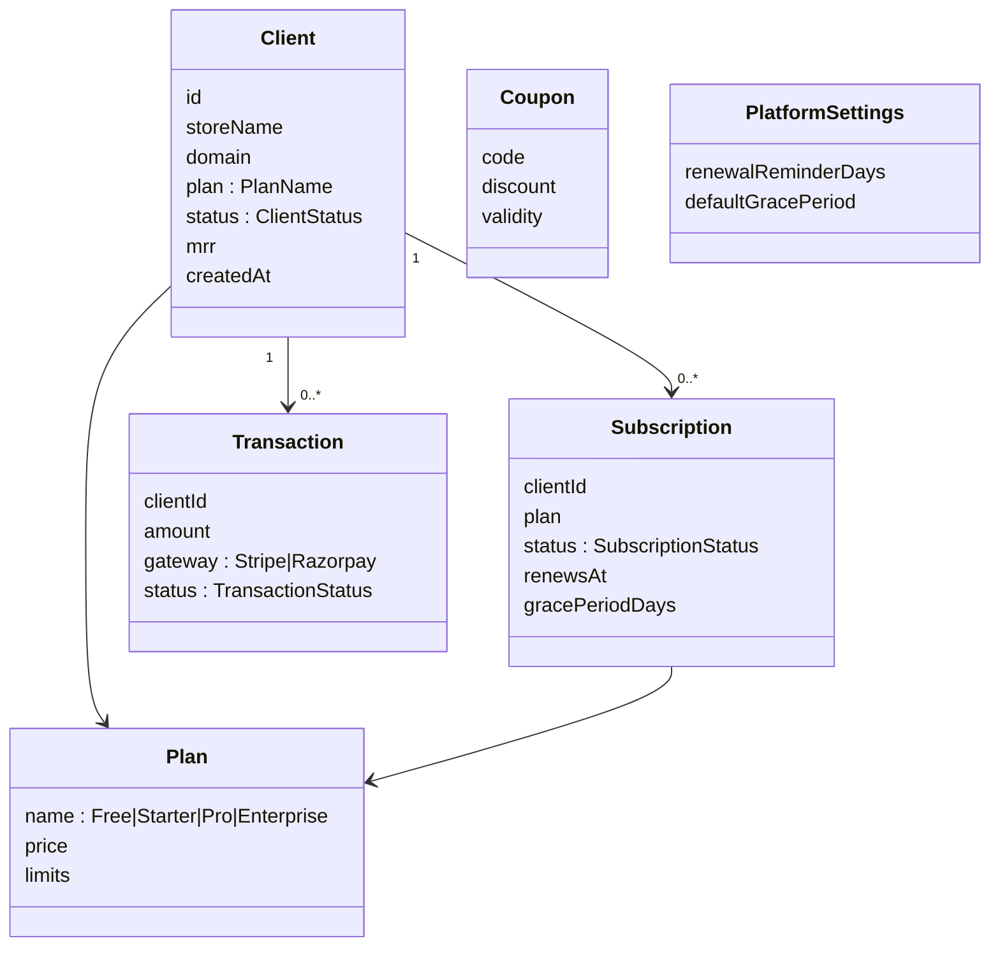
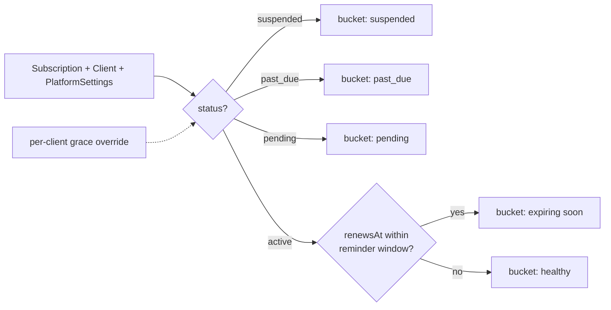
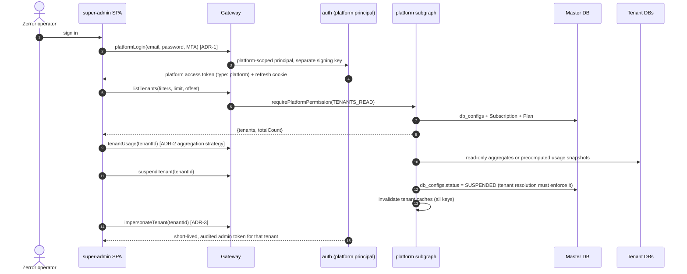
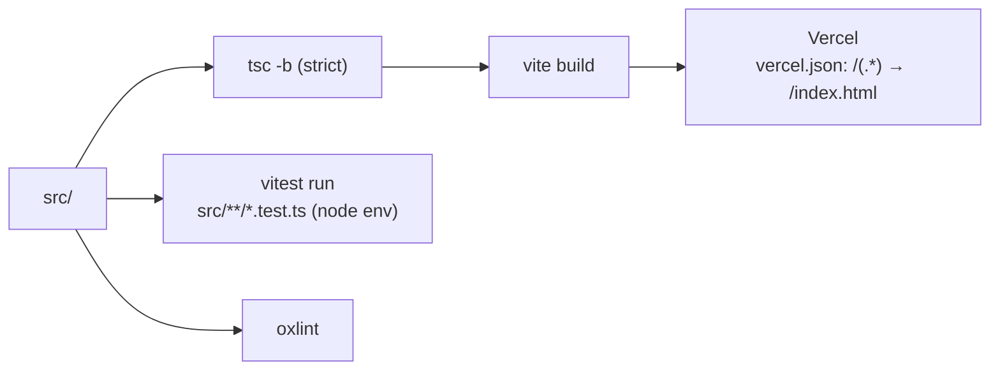

# zcom-super-admin: Solution Architecture (Platform Console)

| | |
|---|---|
| **Status** | Living document. Verified against code on **2026-10-13** |
| **Parent** | Workspace `../ARCHITECTURE.md` |
| **Maturity** | **API-only (PRD-005 Phases 0–4, 2026-10-17).** Real sign-in, stores, lifecycle, subscriptions, billing, reports, Team, audit and impersonation from the `platform-admin` subgraph; the mock prototype was removed (Q14). Not yet run in a browser against a live gateway. |

---

## 1. Purpose

This is Zerror Studios' internal console for operating the Zcom platform:
- onboarding and managing **client stores** (tenants);
- plans and subscriptions, billing transactions and revenue reports;
- coupons and renewal-reminder automation;
- a per-client view of usage and health, with an "impersonate store" action.

Tenant staff use `zcom-frontend`; this console sits *above* all tenants.

## 2. Context: current vs target

## 3. Application architecture (current)

### Route map

| Route | Page | Sections / notes |
|---|---|---|
| `/sign-in` | SignIn | Behind `GuestOnly`. Fake auth accepts any credentials |
| `/` | Home | KPI cards (revenue, MRR, stores, orders), revenue chart, plan mix, top clients |
| `/clients` | Clients | Table with status and health |
| `/clients/new` | AddClient | Plan (Free/Starter/Pro/Enterprise), status (trial/active/suspended) |
| `/clients/:id` | ClientDetail | Overview / Billing / Usage tabs, danger zone, "Login as store" |
| `/billing/:section` | Billing | `subscriptions`, `transactions` |
| `/analytics/:section` | Analytics | `revenue` |
| `/settings/:section` | Settings | `discounts` (coupons), `billing-rules` (platform settings), `team` (platform users, API only), `audit` (audit log, API only); `automation` redirects to `/billing/reminders` |

## 4. Domain model (front-end types)

**Mismatch to resolve in the integration PRD.** The backend's master-DB `Plan.name` enum is `STARTER | PREMIUM | PLUS | ENTERPRISE`, and `Subscription.status` is `ACTIVE | TRIAL | PAST_DUE | CANCELLED | SUSPENDED`. The console uses `Free/Starter/Pro/Enterprise` and its own status set. One vocabulary must be chosen.

## 5. Subscription-health logic (tested core)

This logic lives in `lib/subscriptionHealth.ts`, which has tests in `subscriptionHealth.test.ts`. The reports in `subscriptionReports.ts` and `revenueReports.ts` reconcile their overview totals with the drill-down counts, and those are tested too.

## 6. Integration architecture (PRD-005)

**Current (Phase 1, 2026-10-17).** The backend has the platform principal (ADR-001, Accepted) and the `platform-admin` subgraph. This repo talks to it through `src/lib/apollo-client.ts` (auth link, silent refresh on `TOKEN_EXPIRED` with a single-flight, cross-tab lock, proactive refresh, error codes), with the access token in memory (`lib/session-store.ts`) and the refresh token in the `__Host-zc_platform_rt` cookie. `AuthProvider` restores the session on load (`platformRefreshToken` → `platformMe`), runs the TOTP step on `MFA_REQUIRED`, and sends manage roles to `/mfa` to enrol. `ClientsProvider` maps `platformTenants` / `platformPlans` onto the console's `Client`, `Subscription` and `Plan` types (`lib/api-adapters.ts`) so every screen reads them unchanged. ADR-5 is answered: Apollo cache for server data, React context for session and UI state only. **Phase 2 (same day):** `ClientsProvider` also runs the lifecycle mutations (create with provisioning, update, notes, suspend with a reason, reactivate, soft delete with the slug), `SettingsProvider` holds the server settings, and the store page gained the provisioning card, subscription actions and editable notes; health and payment badges are server-computed (ADR-2 answered with daily usage snapshots in the master DB).

**Target (Phases 2–4).** The sequence below is the full design from the PRD; the identity decision (ADR-1 here) is ADR-001 in the backend and is done.

| ADR | Decision needed |
|---|---|
| ADR-1 | **Platform identity:** a separate principal, key and cookie, or the existing admin with a platform scope. MFA requirement. |
| ADR-2 | **Cross-tenant metrics:** fan-out queries, an event-driven usage collection in the master DB, or the analytics service |
| ADR-3 | **Impersonation ("Login as store"):** token minting, expiry, audit trail |
| ADR-4 | **Platform billing provider:** Stripe or Razorpay (the console types) vs Nimbbl (tenant payments) |
| ADR-5 | **Client state after integration:** keep React context, or adopt Apollo cache conventions like zcom-frontend |

## 7. UI system

| Concern | Choice |
|---|---|
| Primitives | HeroUI 2.8 |
| Styling | Tailwind **v4**, configured in CSS: `@theme` tokens in `src/index.css`, and `@plugin "../hero.ts"` (light theme, primary `#3b82f6`) |
| Kits | `components/common/*Styles.ts`, `styles/inputStyle.ts`, `PageHeader`, `ConfirmModal`, `StatusChip`, `TableToolbar`, `NoDataPlaceholder` |
| Charts | recharts |
| Icons | lucide-react (preferred for new icons); react-icons in older files |
| Theme | Light only (`dark` class removed on mount) |

## 8. Build, test and deploy

## 9. Risks and gaps

| Gap | Impact | Path |
|---|---|---|
| Vercel topology | `/v1/graphql` has no rewrite and a `SameSite=Strict` cookie cannot cross sites, so sessions cannot be kept on Vercel as configured | PRD-005 Q6: serve the console behind the CloudFront edge or add the rewrite (review C-H3) |
| Vocabulary mismatch with backend plans and statuses | Integration bugs | Settle it in the PRD |
| No notifications feed | The panel is empty | Feed it from `platformAuditLog` or events (T1) |
